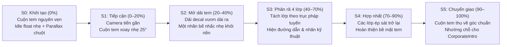

# Kế hoạch Triển khai & Thiết kế — Sunflower Website v2.5

> **Lượt 4 · E1 · 2026-10-19:** Chủ dự án yêu cầu làm vòng xoay Sản phẩm trước. Hero `/san-pham` đã có sáu cutout trên quỹ đạo ellipse, chọn họ/trước–sau/pause, link tới catalog; mobile chọn thủ công. Phạm vi/storyboard: [products-orbit.md](./storyboards/products-orbit.md); kết quả/giới hạn: [PRODUCTS_ORBIT_REPORT.md](./PRODUCTS_ORBIT_REPORT.md). Chờ review riêng E1. Homepage vẫn poster; E2/3D chưa triển khai, cả lượt 4 chưa hoàn tất. Các ghi chú “chưa orbit” bên dưới là lịch sử.

> **Header mới nhất · 2026-10-17:** Đã thêm menu bấm mở cho Sản phẩm (6 họ/13 nhóm), Giải pháp (4), Năng lực (4); desktop dropdown/mobile accordion, xem toàn trang, bàn phím/Escape/click ngoài/resize. Sửa chọn lại cùng hash khi danh mục đang bị filter ẩn. Lint/typecheck/build và QA đạt; [HEADER_DROPDOWN_REPORT.md](./HEADER_DROPDOWN_REPORT.md) có ảnh/bằng chứng/giới hạn. Orbit/3D vẫn làm cuối.

> **Bổ sung UI mới nhất · 2026-10-17:** Đã chỉnh typography/layout theo góp ý Word và xác nhận triển khai của chủ dự án: chữ sans dễ đọc, Giới thiệu có khối/ảnh/cutout, Ứng dụng/Năng lực phân tầng, bảng chất liệu responsive server-rendered. Lint/typecheck/build và 28 baseline + 320px đạt; [TYPOGRAPHY_LAYOUT_REPORT.md](./TYPOGRAPHY_LAYOUT_REPORT.md) ghi kiểm chứng/giới hạn. Chờ review giao diện; đây không phải lượt 4. Khối tròn/orbit/3D tiếp tục làm cuối.

> **Tiến độ mới nhất · 2026-10-17:** **Lượt 3 mới đã hoàn tất code/checks, chờ review giao diện**. Đã polish bố cục/copy/responsive, native details, cutout Giải pháp/Dự án, focus/form/menu và kiểm tra 7 trang × 4 viewport + 320px. Lint/typecheck/build đạt. [POLISH_ROUND3_REPORT.md](./POLISH_ROUND3_REPORT.md) ghi bằng chứng và giới hạn QA. Lượt 4 chưa bắt đầu; homepage giữ poster, chưa orbit/3D.

> **Cách chia mới nhất do chủ dự án xác nhận · 2026-10-17:** **4 lượt code mới**: (1) catalog 13 cutout + Hero Sản phẩm tĩnh; (2) năm Hero còn lại; (3) hoàn thiện giao diện/responsive/motion nhẹ/QA; (4) vòng xoay Sản phẩm → Hero 3D trang chủ → QA tích hợp. Cách gọi này thay cách gộp vào lượt 3–4 cũ bên dưới. Lượt 1 và lượt 2 đã có kết quả; báo cáo tương ứng `CATALOG_ROUND1_REPORT.md` và `INTERIOR_ROUND2_REPORT.md`. Tiến độ hiện hành ở 9.11; motion nâng cao chưa triển khai.

> **Hướng thiết kế đã chốt · 2026-10-17:** Phạm vi tách nền áp dụng cho đủ **13 nhóm trong catalog**. Sáu trang con có Hero riêng theo bộ chọn hình/mockup tại `docs/HERO_ASSET_SELECTION.md`, nay đã áp dụng vào cổng 3010 qua lượt 1–2 mới. Hero trang chủ giữ poster, vòng xoay và 3D ở bước motion cuối.

> **Phong cách chủ đạo:** Refined Industrial Minimalism (lấy cảm hứng từ MWDT, Revolve Robotics) kết hợp **Immersive 3D Hero** (lấy cảm hứng từ Fizzi 3D & Ori Scan).  
> **Cập nhật:** 2026-10-17 · Kế hoạch tinh chỉnh demo theo 6 yêu cầu mới, Hero full màn hình và phương án rút gọn còn **4 lượt code** được chủ dự án đồng ý.
> **Môi trường:** Demo thử nghiệm tại local; chưa triển khai production, chưa chạy database theo xác nhận của chủ dự án. Không kết nối ERP, CMS, email/webhook thật hoặc tự deploy trong các lượt tinh chỉnh dưới đây.
> **Trạng thái thực tế:**
> - **Giai đoạn 0–1:** Có mockup/storyboard cũ (tài liệu ghi đã duyệt) và nền tảng Next.js hoàn chỉnh.
> - **Giai đoạn 2–3:** Đã có code demo trang chủ 3D và đủ 6 trang con; đang cần rà soát/duyệt chất lượng, không còn ở trạng thái chuẩn bị triển khai.
> - **Giai đoạn 4:** Có API validation và nhánh webhook; chưa xác nhận tích hợp nhận báo giá thật. Khi không có `INQUIRY_WEBHOOK_URL`, API chỉ trả `staging_validated`, không lưu database hoặc gửi email.
> - **Giai đoạn 5:** Chưa hoàn tất QA tổng thể/triển khai. Lượt 3 ngày 2026-10-17 đã kiểm tra browser ở 320/390/768/1440/1920px, tương tác và đường dẫn; lint/typecheck/build đạt. Các giới hạn reduced-motion/no-JS browser, zoom, Lighthouse và thiết bị thật ghi tại `ROUND3_REPORT.md`.
> **Điểm tiếp tục · 2026-10-17:** Trang chủ giữ Hero poster, không mount scene 3D, không pin hoặc dành khoảng cuộn cho timeline. Giữ prototype và bộ React 19 + R3F 9 + Drei 10 đã đồng bộ để tái sử dụng cuối cùng. **Lượt 1–2 mới đã có code/checks; đủ bảy trang có Hero riêng.** Review kết quả mới tại `INTERIOR_ROUND2_REPORT.md`, sau đó tiếp tục lượt 3 mới khi chủ dự án yêu cầu. Cách chia/tiến độ hiện hành ở **9.11**; 9.10 giữ phạm vi kỹ thuật. 3D chưa nghiệm thu; Blender → GLB vẫn chỉ là đề xuất.
> **Phạm vi hiện hành:** Hoàn thiện catalog `/san-pham`, sáu Hero trang con và thành phần dùng chung cần thiết; giữ poster homepage, đủ 7 route, 13 nhóm sản phẩm và luồng liên hệ. Chỉ chỉnh sửa demo local, không scaffold lại ứng dụng.

**Cách đọc tài liệu:** Mục 1–8 lưu tài nguyên, phương án và bằng chứng của bản demo trước. Mục 9 là kế hoạch hiện hành theo yêu cầu ngày 2026-10-17; các mô tả cũ về khối giải thích `MaterialStory`, giao diện S0–S5 và số lượng sản phẩm trên homepage được thay bằng mục 9. Các yêu cầu mới của chủ dự án được ưu tiên khi tài liệu v2.1 chưa cập nhật tương ứng.

---

## 1. Kiểm toán Tài nguyên Hiện có & Rủi ro Bản quyền (`references/intake/` & `references/hero-3d/`)

Theo quy tắc trong `AGENTS.md` (Mục 3 & 4), website không được đăng tải hình ảnh có chứa nhãn hiệu/logo của bên thứ ba khi chưa có giấy phép, và không được dùng ảnh nhà máy stock để khẳng định là nhà xưởng thực tế của Sunflower. Dưới đây là kết quả rà soát từng file:

| Nhóm / Mục đích | File gốc | Đánh giá & Phát hiện | Trạng thái sử dụng trên Web |
| :--- | :--- | :--- | :--- |
| **Thương hiệu** | `sunflower-logo.png` | Logo gốc (bánh răng xanh đậm `#002B5B` + chữ S trắng + cuộn tem vàng `#FFC000`), ảnh raster PNG nền trong suốt, chưa có chữ "SUNFLOWER" đi kèm. | **Đã vẽ lại SVG chuẩn xác (`SunflowerLogo.tsx`)** từ cấu trúc gốc + tạo 2 biến thể Monochrome/Neutral (`mono-charcoal` trên nền sáng, `mono-light` trên nền tối, điểm xuyết Muted Bronze `#9B8974`). |
| **Hero 3D Art Direction** | `01-floating-label-studio-hires-AI-concept.png` | Ảnh concept AI 16:9 độ phân giải cao, ánh sáng studio ấm, cuộn tem trắng lõi giấy kraft đang bung dải tem rất đẹp. | Dùng làm **Art Direction chuẩn** cho cảnh R3F 3D và làm **Poster tĩnh tạm thời** ở môi trường dev (`rightsStatus: "illustrative_dev_only"`). |
| **1. Tem trắng dạng cuộn** | `tem-trang-cuon.webp` | Ảnh sạch, 2 cuộn tem trắng lõi nâu trên nền xám sáng, không dính logo bên thứ ba. | **Dùng được ngay (`approved`)** — chuẩn hóa trên sân khấu nền `#EAE6DF` / `#F6F4EF`. |
| **2. Tem màu dạng cuộn** | `tem-mau-cuon.webp` | ⚠️ Có nhãn hiệu bên thứ ba: *"Black Raven Brewing Co."*, *"Ample Hills"*, *"Wilson"*, và chữ *"YOUR DESIGN HERE"*. | **Chỉ dùng làm placeholder dev (`illustrative_dev_only`)** kèm nhãn `Ảnh minh họa`. Cần thay bằng ảnh chụp sản phẩm thật được phép công bố trước khi go-live. |
| **3. Tem trắng dạng tờ** | `tem-trang-to.webp` | ⚠️ Trên mép tờ giấy in rõ logo **Avery®** và mã template. | **Placeholder dev (`illustrative_dev_only`)** — cần xóa/crop phần logo Avery hoặc thay ảnh mới trước khi xuất bản. |
| **4. Tem màu dạng tờ** | `tem-mau-to.webp` | ⚠️ In tên thương hiệu **YARDSALE.NZ** trên nền bàn gỗ (lệch chuẩn nền studio). | **Placeholder dev (`illustrative_dev_only`)**, cần thay ảnh nền đồng nhất. |
| **6. Mực in Ribbon** | `muc-in.webp` | ⚠️ Các cuộn ribbon in logo **Zebra** (1600, 2000, 6000). | Chỉ giữ nếu Sunflower thực sự phân phối ribbon Zebra chính hãng; hiện gắn cờ `illustrative_dev_only`. |
| **7. Máy in mã vạch** | `may-in.webp` | Máy in để bàn thương hiệu **TSC**. | Hợp lệ nếu Sunflower cung cấp thiết bị TSC (gắn nhãn thông số minh họa `illustrative_dev_only`). |
| **10. Thẻ bài** | `the-bai.webp` | ⚠️ Thẻ bài in logo **Mizuno** và chữ tiếng Nhật trên nền gỗ. | **Placeholder dev (`illustrative_dev_only`)**, không công bố thương mại nếu chưa có quyền. |
| **11. Tem dệt** | `tem-det.webp` | ⚠️ In rõ *"CREATIONS BY GUZMAN EST. 1984"*. | **Placeholder dev (`illustrative_dev_only`)** kèm ghi chú minh họa chất liệu dệt. |
| **13. Băng dính** | `bang-dinh.webp` | ⚠️ Có nhãn *"Shop Local Kentucky Brewed Tees"*, *"babbq"*, chụp flat-lay trên sàn gỗ tối. | **Placeholder dev (`illustrative_dev_only`)**, lệch tông màu studio sáng của hệ thống. |
| **Nhóm còn thiếu ảnh** | *Giấy (`giay`), Máy quét mã vạch (`may-quet-ma-vach`), Hộp (`hop`), Tem vải nylon/satin (`tem-vai-nylon-satin`)* | Hiện chưa có file ảnh riêng trong thư mục `references/intake/`. | Tự động hiển thị **Studio Technical Placeholder** đồng bộ tông màu `#EAE6DF` có ghi `TODO_ASSET: Chờ bổ sung ảnh thực tế` (`rightsStatus: "todo_asset"`). |
| **Ảnh xưởng / máy in** | `printing-press-*`, `printing-workshop-*`, `press-operators-*`, `print-color-samples-*`, `large-format-*`, `office-interior.png` | Ảnh stock từ Unsplash (có biển báo tiếng Anh, công nhân nước ngoài). | Dùng cho mục quy trình/năng lực nhưng **bắt buộc gắn chú thích nhỏ `Hình ảnh minh họa quy trình công nghiệp`** — không viết caption gây hiểu lầm là nhà máy Sunflower. |

---

## 2. Phương án Biến thể Logo Đơn sắc / Trung tính (`src/components/ui/SunflowerLogo.tsx`)

Dựa trên file `sunflower-logo.png` (biểu tượng bánh răng 8 cạnh + chữ **S** âm bản + cuộn tem 3 ô đang trải ra), component SVG Vector được dựng với 3 chế độ hiển thị giữ nguyên 100% cấu trúc nhận diện gốc:

1. **Biến thể Light Mode (`mono-charcoal` — Mặc định trên Header nền Ivory `#F6F4EF`):**
   - Thân bánh răng & viền cuộn tem: Charcoal `#171715`.
   - Chữ **S** & lõi cuộn tem: Nền sáng `#F6F4EF`.
   - 2 răng bánh răng điểm nhấn & 3 mặt tem trên dải cuộn: Muted Bronze `#9B8974` (thay cho màu vàng chói, tạo điểm nhấn kim loại trầm sang trọng đúng chất công nghiệp).
   - Đi kèm Wordmark **SUNFLOWER** bên phải bằng font `Inter` Bold, tracking `-0.02em`.
2. **Biến thể Dark Mode (`mono-light` — Dùng ở Footer / Section nền Graphite `#171715`):**
   - Thân bánh răng & chữ: Warm White `#F9F7F2`.
   - Chi tiết mặt tem: Muted Bronze `#9B8974`.
3. **Biến thể Original (`brand-original`):** Giữ nguyên màu Xanh Navy `#002B5B` / Vàng `#FFC000` gốc nếu chủ dự án muốn bật lại qua prop `variant="brand-original"`.

---

## 3. Storyboard cũ — Lưu để đối chiếu bản demo

**Đã được thay thế về hướng trình bày bởi mục 9.** S0–S5 bên dưới là storyboard cũ; không tiếp tục xây khối giải thích vật liệu, callout kỹ thuật hoặc thanh điều khiển S0–S5 trên giao diện mới. Tách lớp vẫn là diễn biến trong Hero.

Phương án cũ đề xuất `HeroProductStage` và `MaterialStory` dùng chung scene với GSAP ScrollTrigger (`pin: true, scrub: 1`). Mã demo được rà soát thực tế đang dùng ScrollTrigger kết hợp CSS sticky, chưa phải toàn bộ phương án này; scene hiện dùng Three.js trực tiếp thay vì R3F/Drei.

### Chi tiết 4 lớp vật liệu chuẩn trong trạng thái S3 (Exploded View)
1. **`01 / Lớp mặt — Facestock`:** Bề mặt giấy decal trắng mờ/bán bóng (hoặc màng PP/PVC/nhiệt tùy cấu hình đơn hàng), nơi tiếp nhận mực in và quyết định độ sắc nét.
2. **`02 / Lớp keo — Adhesive`:** Lớp keo acrylic/hotmelt trong suốt, quyết định độ bám dính trên bao bì nhựa, thủy tinh, thùng carton hoặc kim loại.
3. **`03 / Lớp chống dính — Silicone`:** Lớp phủ mỏng giúp con tem tách khỏi đế dễ dàng khi dán tự động bằng máy hoặc dán tay.
4. **`04 / Lớp đế — Release Liner`:** Giấy đế Glassine/Kraft chịu lực kéo trên máy in mã vạch và máy dán nhãn tốc độ cao, cố định khoảng cách bế (gap).

---

## 4. Bộ Mockup Giao diện đã duyệt (Giai đoạn 0)

Các ảnh dưới đây thuộc phương án trước, được tài liệu cũ ghi nhận đã duyệt; không phải nghiệm thu cho hướng tinh chỉnh ngày 2026-10-17. Bộ mockup mới được lập ở bước chuẩn bị, mục 9.3.

### 4.1. Header & Hero 3D — Desktop (`1440×900`)

### 4.2. Storyboard 3D — Tách 4 Lớp Vật liệu theo Cuộn trang (`MaterialStory` — Bước S3)

### 4.3. Hero — Mobile (`390×844`)

### 4.4. Product Showcase — Editorial Alternating Rows (Trang chủ & `/san-pham`)

### 4.5. Section Năng lực Sản xuất (`Capabilities`) + CTA Báo giá & Footer

---

## 5. Lộ trình 6 Giai đoạn (Phase 0 → Phase 5)

| Giai đoạn | Hạng mục công việc chính | Trạng thái |
| :--- | :--- | :--- |
| **Giai đoạn 0** | Đồng bộ tài liệu v2.1 (`AGENTS.md`, `DESIGN_SYSTEM.md`, `PAGE_STRUCTURE.md`), kiểm toán bản quyền ảnh, dựng 5 bản Mockup & Storyboard 3D. | ✅ **Hoàn thành** |
| **Giai đoạn 1** | Khởi tạo Next.js 15 + TypeScript + Tailwind CSS + GSAP + R3F/Drei; thiết lập Design Tokens (`globals.css`), `SunflowerLogo`, `SiteHeader`, `SiteFooter`, dữ liệu `src/content/` (13 nhóm sản phẩm) và khung 7 route cấp 1. | ✅ **Hoàn thành** |
| **Giai đoạn 2** | Đã có Hero 3D, tách lớp và các section trang chủ. Tinh chỉnh chất lượng hình ảnh, motion và mật độ nội dung theo mục 9. | 🟡 **Có demo · cần duyệt lại** |
| **Giai đoạn 3** | Đã có 6 trang con: `/san-pham`, `/gioi-thieu`, `/nang-luc`, `/giai-phap`, `/du-an`, `/lien-he` và ngữ cảnh `?san-pham=`, `?nhu-cau=`, `?du-an=`. | 🟡 **Hoàn tất code demo · chờ duyệt** |
| **Giai đoạn 4** | Có API validation/chế độ staging và nhánh webhook; tích hợp nhận báo giá thật, Zalo/PDF còn chờ dữ liệu chính thức. | 🟡 **Một phần · chưa kích hoạt chức năng thật** |
| **Giai đoạn 5** | Typecheck/build đạt khi rà soát; cần kiểm thử responsive, motion, accessibility, hiệu năng và đủ mốc duyệt. | ⏳ **Chưa hoàn tất QA · deploy để đợt riêng** |

---

## 6. Kết quả Kiểm chứng Thực tế — Giai đoạn 1 (Foundation & Design System)

Ảnh chụp màn hình thực tế từ trình duyệt sau khi hoàn thành `npm run build` ở Giai đoạn 1:

### Desktop (`1440×900`)

### Mobile (`390×844`)

---

## 7. Kết quả Kiểm chứng Thực tế — Giai đoạn 2 (3D Hero, Tách 4 Lớp Vật liệu & Trang chủ `/`)

Ảnh chụp màn hình thực tế từ trình duyệt sau khi hoàn thành `npm run build` ở Giai đoạn 2 (đã lưu trong `docs/mockups/`):

### 7.1. Hero 3D — Trạng thái S0 (Cuộn tem nguyên vẹn — Desktop `1440×900`)

### 7.2. Storyboard 3D — Trạng thái S3 (Phân rã 4 lớp vật liệu & chỉ dẫn kỹ thuật — Desktop `1440×900`)

### 7.3. Danh mục Sản phẩm & Vật tư chủ lực (Editorial Alternating Rows — Desktop `1440×900`)

### 7.4. Năng lực Sản xuất & Quy trình 4 bước (Section nền Charcoal `#171715` — Desktop `1440×900`)

### 7.5. Giao diện Mobile (`390×844`) — Hero & Sân khấu 3D

---

## 8. Phase 3 — 6 trang nội dung + API báo giá (Hoàn tất code · 2026-10-16 · chờ duyệt)

| Route | Section module | Trạng thái |
|---|---|---|
| `/san-pham` | `src/sections/products/ProductsCatalogueView.tsx` | ✅ 13 nhóm, lọc theo họ, anchor bar, bảng so sánh vật liệu |
| `/gioi-thieu` | `src/sections/about/AboutContentSections.tsx` | ✅ câu chuyện, fact sheet `TODO_CONTENT`, nguyên tắc B2B |
| `/nang-luc` | `src/sections/capabilities/CapabilitiesDetailSections.tsx` | ✅ 4 năng lực, quy trình 4 bước, checklist QC |
| `/giai-phap` | `src/sections/solutions/SolutionsDetailSections.tsx` | ✅ 4 giải pháp ngành, liên kết sản phẩm |
| `/du-an` | `src/sections/projects/ProjectsShowcaseSections.tsx` | ✅ lọc danh mục, nhãn trạng thái công bố (demo) |
| `/lien-he` | `src/sections/contact/QuoteRequestForm.tsx` | ✅ đọc `?san-pham=`, `?nhu-cau=`, `?du-an=`; trường quy cách động |
| `POST /api/inquiries` | `src/app/api/inquiries/route.ts` | ✅ kiểm tra server-side; chế độ `staging_validated` khi chưa có `INQUIRY_WEBHOOK_URL` |

**Kiểm tra được tài liệu cũ ghi nhận (2026-10-16):** `tsc --noEmit` đạt · `next build` đạt (13/13 trang) · 7 route trả 200 · API: payload sai → 400 kèm lỗi theo trường; payload hợp lệ → 200 + mã tham chiếu `SF-YYYYMMDD-xxxx`. Lần rà soát 2026-10-17 đã chạy lại typecheck/build đạt; chưa chạy lại kiểm thử HTTP/API hoặc nghiệm thu motion trên trình duyệt. Số trang sinh trong build bao gồm route hệ thống, không phải 13 trang cấp 1.

**Ảnh nghiệm thu:** `docs/mockups/phase3-{products,about,capabilities,solutions,projects,contact}-desktop-1440x900.png`, `phase3-products-mobile-390x844.png`.

**Còn mở:** email/hộp thư nhận báo giá chính thức (SMTP/webhook), số Zalo, PDF hồ sơ năng lực, ảnh thật & thông số từng nhóm sản phẩm, dự án được phép công bố.

---

## 9. Kế hoạch hiện hành — Tinh chỉnh landing page demo (2026-10-17)

### 9.1. Sáu yêu cầu đã thống nhất về hướng xử lý

| Yêu cầu của chủ dự án | Đích thiết kế / hành vi | Lượt thực hiện |
|---|---|---|
| Top nav chưa ấn tượng | Header hòa vào Hero ở đầu trang, thu gọn khi scroll; menu/CTA có thứ bậc, mobile menu có chuyển động và hỗ trợ bàn phím. | Chuẩn bị; 1, 3 |
| Hero đơn giản, thiếu chiều sâu và chi tiết phụ; cần dạng full theo ảnh bổ sung | Scene studio phủ toàn chiều ngang và gần trọn viewport; chữ/CTA cùng không gian với cuộn tem chính, dải tem uốn, nhãn bóc và 2–3 chi tiết phụ; ánh sáng/bóng đổ và camera nhiều góc có kiểm soát. | Chuẩn bị; 1, 2 |
| Chỉ cần chuyển động/tách lớp; bỏ giải thích vật liệu | Bỏ khối “Từ lớp vật liệu đến cuộn tem hoàn thiện”, danh sách/callout giải thích và bảng điều khiển S0–S5; giữ tách lớp bên trong Hero. | 1, 2 |
| Section phẳng, nhiều chữ | Nhịp ivory → beige → graphite → nền sáng → CTA/Footer tối; hình lớn, ít hộp viền; giảm nội dung lặp và chuyển thông số dài về trang con. | Chuẩn bị; 3 |
| Ít motion | Một sequence 3D chính, thêm heading reveal, chuyển sản phẩm, ảnh reveal, một tiến trình quy trình và micro-interaction. | 2, 3 |
| Sản phẩm cần tách vật thể | Ảnh tách nền trong suốt đặt trực tiếp trong bố cục; model 3D cho sản phẩm cần xoay nhiều mặt. | 3 |

**Nguyên tắc hình ảnh:** Giữ warm neutral/charcoal, headline `Tem nhãn. Tạo dấu ấn.` và một chủ thể chính mỗi cảnh. Chủ dự án yêu cầu thêm sản phẩm trong 13 nhóm và khối cầu nhưng nhấn mạnh cuộn tem phải là main, tổng thể sang trọng/hài hòa. Đề xuất mới nhất ở concept 03: cuộn tem trắng lớn, hộp giấy ivory thấp ở sau, thẻ bài ivory, mẫu nhãn satin nhỏ và hai khối cầu champagne trầm; bỏ cuộn tem in thứ hai để giảm cạnh tranh. Phối cảnh/asset cụ thể còn chờ duyệt, luôn giữ vùng chữ/CTA thoáng. Khối cầu là ngoại lệ trang trí được chủ dự án yêu cầu riêng cho Hero, không tự mở rộng sang các section khác. Không thêm icon/hạt trang trí, thay biểu tượng logo, tạo số liệu hoặc khẳng định năng lực chưa được xác nhận.

**Tham chiếu:** [MWDT](https://mwdtinc.com/) cho tương phản, vật thể lớn, nhịp chuyển Hero → nội dung; [case study tác giả](https://kristopherray.com/projects/mwdt/) cho sequence 90 frame + GSAP ScrollTrigger. Ảnh chủ dự án gửi trong chat ngày 2026-10-17 là tham chiếu bố cục/ánh sáng, không phải model hoặc bằng chứng sản phẩm. Dùng art direction có sẵn tại `references/hero-3d/01-floating-label-studio-hires-AI-concept.png`; không phụ thuộc đường dẫn clipboard tạm thời.

#### Bổ sung của chủ dự án — Hero dạng full (2026-10-17)

Ảnh bổ sung gồm hai concept: hệ sản phẩm bao bì ở trên và cuộn tem trắng ở dưới. Ban đầu dùng để xác định cách phủ cảnh và bố trí nội dung; sau khi xem bản 01, chủ dự án yêu cầu thêm vài loại sản phẩm và khối tròn giống panel trên. Bản 02 minh họa hộp giấy, thẻ bài, cuộn tem in nhỏ hơn và ba khối cầu; không sao chép logo/artwork trong ảnh tham chiếu. Cuộn tem trắng vẫn là chủ thể chính, giữ headline `Tem nhãn. Tạo dấu ấn.`.

- **Bề rộng:** Nền studio và canvas/poster phủ 100% chiều ngang viewport, không bị giới hạn trong container 1320px. Khối chữ vẫn theo lề và chiều rộng đọc của hệ thống; không có ô 3D bên phải, đường viền hoặc hai panel nền tách biệt. Viền ngoài ảnh tham chiếu không phải yêu cầu tạo card cho Hero.
- **Chiều cao:** Desktop hướng tới một màn hình mở đầu gần/trọn viewport (`min-height` theo `svh`, điều chỉnh theo cách đặt header). Không khóa chiều cao khiến text bị cắt; mobile, màn hình thấp và zoom 200% cho phép Hero cao hơn một viewport để giữ CTA truy cập được.
- **Bố cục:** Headline, mô tả ngắn và CTA là HTML phủ trên cùng cảnh, bên trái trên desktop; cuộn tem lớn ở vùng phải/giữa. Dải tem và vật liệu có thể đi qua các vùng tiền cảnh/hậu cảnh, giữ khoảng trống an toàn quanh chữ. Canvas trải toàn Hero kể cả phía sau vùng chữ, có thể giữ vùng đó thoáng bằng ánh sáng và bố trí vật thể.
- **Header:** Hòa vào đầu cảnh với nền trong/nhẹ khi đủ contrast; chuyển nền đặc và thu gọn khi scroll. Bố trí chiều sâu không che logo, menu hoặc CTA; không tăng khoảng trống thành một dải riêng trên Hero.
- **Chiều sâu:** Dùng ánh sáng studio ấm, nền liền sàn, bóng tiếp xúc và độ mờ có kiểm soát. Cho phép cắt một phần dải tem/chi tiết phụ ở mép màn hình để tạo cảm giác cảnh tiếp diễn; ở pose mở đầu phải đọc rõ cuộn tem và lõi, không cắt chủ thể tới mức khó nhận biết.
- **Scroll:** Toàn cảnh dùng chung một timeline mở dải → tách lớp → hợp lớp → chuyển sang sản phẩm. Text nhường chỗ theo storyboard và được kiểm tra khả năng đọc; không xuất hiện khối giải thích vật liệu riêng.
- **Mobile/fallback:** Dàn lại text ở phía trên và vật thể ở giữa/dưới trong cùng nền; đổi camera/crop theo tỷ lệ dọc, không thu nhỏ nguyên bố cục desktop. Poster fallback dùng cùng bố cục và có khoảng trống cho HTML; không nhúng lại chữ/CTA có sẵn trong ảnh concept gây trùng lặp. Lớp canvas trang trí không chặn thao tác với liên kết.

**Tiêu chí duyệt bổ sung:** Ảnh đầu trang phải đọc thành một cảnh studio liền mạch, chữ và sản phẩm chung không gian; không còn cảm giác text cạnh một khung trình diễn. Kiểm tra ít nhất 1440×900, 768×1024 và 390×844, đồng thời xem trạng thái đầu trang/khi cuộn của header.

### 9.2. Thứ tự thực hiện và mốc duyệt

**Phương án hiện hành: 4 lượt code + một bước chuẩn bị thiết kế ngắn.** Thứ tự tiếp tục là **poster ổn định → bổ sung lượt 3: asset/cutout 13 nhóm + sáu Hero → lượt 4 QA giao diện tĩnh → vòng xoay Sản phẩm → Hero 3D trang chủ → QA tích hợp**. Các bước nhỏ trong mục 9.10 là hạng mục của hai lượt còn lại, không phải các lượt code mới. Phần 3D từ lượt 2 được hoãn, không phải đã nghiệm thu hoặc bị loại khỏi mục tiêu.

| Lượt | Kết quả chính | Phụ thuộc | Trạng thái |
|---|---|---|---|
| **Chuẩn bị — Không tính lượt code** | Mockup ngắn Header → Hero full → Sản phẩm, storyboard và lựa chọn asset; duyệt chung hướng thiết kế. | Kế hoạch này | Concept 03 đã duyệt; chủ dự án cho phép code lượt 1. Pose/motion còn chuẩn bị trong lượt 2 |
| **1 — Header & Hero tĩnh** | Header hòa cảnh; Hero full chiều ngang/gần trọn viewport với text/CTA phủ cùng nền; bỏ khung kỹ thuật và phần giải thích vật liệu. | Duyệt concept 03 và yêu cầu bắt đầu lượt 1 | Hoàn tất code/checks · có kết quả bàn giao, chưa tự đánh dấu owner nghiệm thu |
| **2 — Prototype 3D, tạm hoãn hoàn thiện** | Đã thử model/timeline; giữ poster trên demo. Phần 3D còn lại chuyển xuống cuối. | Lượt 1 | Chủ dự án chọn giữ poster; prototype chưa nghiệm thu |
| **3 — Landing page + bổ sung catalog/Hero trang con** | Homepage đã có; bổ sung đủ 13 nhóm catalog tách nền và sáu Hero trang con có thiết kế riêng. | Hướng/mockup đã trình; chủ dự án yêu cầu lập kế hoạch tiếp theo | Homepage có kết quả; phần bổ sung chưa code. Kế hoạch chi tiết tại 9.10; bộ chọn hình tại HERO_ASSET_SELECTION.md |
| **4 — QA, motion cuối cùng & bàn giao demo** | QA giao diện trước; sau đó vòng xoay Hero Sản phẩm, model/camera/tách lớp Hero trang chủ và QA tích hợp, fallback, hiệu năng. | Hoàn thiện phần bổ sung lượt 3 và duyệt kết quả giao diện | Chưa bắt đầu; chưa bật vòng xoay hoặc Hero 3D |

**Mốc duyệt hiện hành:** Review trang Sản phẩm với đủ 13 cutout; sau đó review đồng bộ sáu Hero/trang chủ còn dùng poster. Khi giao diện còn lại hoàn thiện, review riêng vòng xoay Sản phẩm và chất lượng model/ánh sáng/chuyển động Hero trang chủ ở cuối lượt 4, rồi QA tích hợp. Các mô tả cũ về 3D trong lượt 2 lưu phạm vi kỹ thuật, không còn chặn lượt 3. Không tự bật lại 3D hoặc đánh dấu nghiệm thu chỉ vì build thành công.

Trước mỗi lượt, đọc lại trạng thái cuối cùng và nêu phạm vi/file/dependency/asset/rủi ro/fallback; không triển khai tất cả các lượt trong một lần. Nếu chỉ được yêu cầu một lượt thì hoàn tất và báo cáo đúng lượt đó. Không cần xin lại các thay đổi đã được chủ dự án cho phép; các mốc trên dùng để duyệt kết quả cụ thể.

### 9.3. Bước chuẩn bị — Mockup, storyboard và kiểm kê asset (không tính lượt code)

**Kết quả đầu tiên (2026-10-17):** Đã tạo [concept Hero desktop 01](./mockups/redesign-v2-hero-desktop-concept-01.png) bằng imagegen tích hợp, lưu [prompt/nguồn](./mockups/redesign-v2-hero-prompt.md) và [storyboard nháp](./storyboards/hero-v2.md). Đây là ảnh AI để chủ dự án xem art direction, chưa phải screenshot trình duyệt, model hoặc UI đã code. Chưa hoàn tất bước chuẩn bị: còn biến thể mobile/tablet, frame camera và phần nối Product Showcase. Chưa duyệt, chưa bắt đầu Lượt 1.

**Điều chỉnh theo phản hồi (2026-10-17):** Đã tạo [concept Hero desktop 02](./mockups/redesign-v2-hero-desktop-concept-02.png): bổ sung hộp giấy ivory, cuộn tem in charcoal, thẻ bài kraft và ba khối cầu kim loại trầm. Giữ bản 01; lưu [prompt/nguồn bản 02](./mockups/redesign-v2-hero-prompt-02.md). Bản 02 chờ duyệt; đây là ảnh concept, không phải sản phẩm thật hoặc asset production.

**Phản hồi tiếp theo (2026-10-17):** Chủ dự án muốn sang trọng/hài hòa hơn và cuộn tem chắc chắn là main. Đã tạo [concept Hero desktop 03](./mockups/redesign-v2-hero-desktop-concept-03.png), chọn `tem-trang-cuon` làm chính, phối `hop`, `the-bai`, `tem-vai-nylon-satin`; giảm khối cầu còn hai, thu nhỏ sản phẩm phụ và thống nhất vật liệu ivory. Bản 03 là hướng đang trình xem, chưa duyệt; giữ bản 01–02 để đối chiếu. [Prompt/nguồn bản 03](./mockups/redesign-v2-hero-prompt-03.md).

**Duyệt và bắt đầu code (2026-10-17):** Chủ dự án xác nhận “oke, duyệt” concept 03 và yêu cầu triển khai lượt 1. Đây là mốc đồng ý mới nhất, thay trạng thái chờ duyệt trong các ghi chép lịch sử phía trên. Responsive desktop/mobile/tablet được kiểm chứng bằng bản code lượt 1; các frame motion chi tiết và chuyển giao Product Showcase tiếp tục ở lượt 2.

**Đầu ra:**

- Mockup mới cho Header + Hero full chiều ngang/gần trọn viewport + phần đầu Product Showcase ở 1440×900, 390×844 và biến thể tablet 768×1024; thêm 1920×1080 khi phù hợp. Thể hiện text/CTA và vật thể trong cùng cảnh, không dùng khung 3D riêng bên phải.
- Các frame camera chính: mở đầu, tiến gần, mở dải, tách lớp, hợp lớp/chuyển section. Đánh dấu vị trí headline/CTA và vùng an toàn cho vật thể trên mobile.
- Bản bố cục toàn trang để nhìn được nhịp nền, độ dài trang và lượng chữ; chọn 3–4 nhóm sản phẩm dự kiến dựa trên chất lượng/quyền asset.
- Danh sách ảnh cần tách nền, model/texture cần dựng, quyền sử dụng và poster dự phòng. Phân biệt ảnh sản phẩm thật, concept và ảnh minh họa.

**File đầu ra dự kiến:** `docs/mockups/redesign-v2-*`, `docs/storyboards/hero-v2.md` (mới), cập nhật tiến độ tại tài liệu này. Sau khi thiết kế được duyệt, đồng bộ các mục bị ảnh hưởng trong `docs/DESIGN_SYSTEM.md` và `docs/PAGE_STRUCTURE.md` trước Lượt 1; không sửa các hợp đồng route/dữ liệu ngoài phạm vi.

**Đạt khi:** Có bản desktop/mobile review được, chọn được hướng header và bố cục scene, storyboard không còn khối giải thích vật liệu. Duyệt chung Header → Hero → Sản phẩm trong một mốc thiết kế ngắn; chỉ bắt đầu Lượt 1 sau mốc này theo quy trình `AGENTS.md`.

### 9.4. Lượt 1 — Header mới, Hero tĩnh và bỏ khối giải thích

**Thay đổi:** Header hòa nền Hero rồi thu gọn trên scroll; CTA tối rõ ràng; menu mobile có focus/Escape/đóng menu đúng hành vi. Hero full chiều ngang/gần trọn viewport: poster/canvas phủ cả cảnh, headline/CTA HTML ở lớp trên với lề đọc phù hợp; đổi bố cục theo mobile, không chia hai panel text/3D. Poster hiện ngay cùng headline/CTA. Bỏ khung viền/lưới kỹ thuật, thanh trạng thái, phần trăm và điều khiển S0–S5 khỏi giao diện chính. Ngừng render khối giải thích `MaterialStory`, bỏ khoảng trống còn lại; giữ dữ liệu kỹ thuật nội bộ nếu scene còn cần.

**File sửa:** `src/components/layout/SiteHeader.tsx`, `src/sections/home/HeroProductStage.tsx`, `src/sections/home/MaterialStory.tsx`, `src/components/three/LabelRollScene.tsx` (phần giao diện), `src/app/globals.css`, `src/content/company.ts`. Tách phần tương tác client khỏi nội dung/poster render sẵn khi cần; chỉ xóa module `MaterialStory.tsx` sau khi xác nhận không còn import.

**Asset/dependency:** Dùng poster hiện có cho demo và logo hiện có; không thêm thư viện, không vẽ lại logo. Chưa cần hoàn thiện model trong lượt này.

**Kiểm tra:** Header đầu trang/khi cuộn, 7 đường dẫn, mobile menu bằng bàn phím, headline/CTA không bị che; poster và nội dung chính vẫn có khi tắt JS. Typecheck/build; ảnh trước/sau desktop/mobile, kiểm tra tablet.

**Rủi ro/fallback:** Header hòa nền có thể thiếu tương phản; dùng nền đặc nếu cần. Nếu scene cũ ảnh hưởng bố cục, tạm dùng poster ở bản demo của lượt này.

**Kết quả triển khai:** Hero đã thành Server Component với HTML H1/CTA, picture art direction và hai poster sạch chữ từ concept 03. Header overlay có trạng thái nền đặc/thu gọn khi cuộn, native mobile menu hoạt động trước JS. Bỏ import/render `MaterialStory` và canvas cũ khỏi trang chủ; giữ các module/dữ liệu 3D cũ để tái sử dụng ở lượt 2, nên giao diện kỹ thuật không được tải/render. Thêm anchor cuộn tới giới thiệu, rút gọn copy theo concept đã duyệt; không sửa API/database. Không thêm dependency.

**Bằng chứng:** [Desktop 1440×900](./mockups/redesign-v2-round1-desktop-1440x900.jpg), [mobile 390×844](./mockups/redesign-v2-round1-mobile-390x844.jpg), [tablet 768×1024](./mockups/redesign-v2-round1-tablet-768x1024.jpg), [menu mobile](./mockups/redesign-v2-round1-mobile-menu.jpg), [Header khi cuộn](./mockups/redesign-v2-round1-header-scrolled-desktop.jpg). [Báo cáo lượt 1](./ROUND1_REPORT.md) ghi checks, giới hạn và rollback. [Prompt poster sạch chữ](./mockups/redesign-v2-round1-poster-prompts.md).

### 9.5. Lượt 2 — Trải nghiệm 3D hoàn chỉnh: scene, camera và scroll

**Ưu tiên mới:** Hoãn toàn bộ việc hoàn thiện/tích hợp thao tác 3D đến sau khi xong các phần còn lại. Demo hiện dùng poster tĩnh; mô tả timeline và kết quả dưới đây lưu lịch sử prototype, không phản ánh giao diện đang bật. Mốc duyệt và thứ tự tại mục 9.2 thay thế yêu cầu duyệt Hero trước lượt 3.

**Tiến độ 2026-10-17:** Đã đồng bộ dependency theo phê duyệt của chủ dự án; scene live chạy trên R3F 9/Drei 10. Có model/vật liệu/studio/props, camera desktop/mobile, native-scroll timeline và poster fallback. Kiểm tra 404 pose geometry đạt tọa độ/normal hữu hạn, không xuyên sàn, không cấp phát geometry khi cuộn, dispose đủ. Có ảnh thật ở 390×844, 768×1024, 1440×900, 1920×1080; refresh giữa sequence, resize, route/back, menu mobile đạt kiểm tra. Lint/typecheck/build đạt. **Chất lượng procedural chưa ngang concept 03; chưa nghiệm thu Hero**, cần review ảnh/demo và đề xuất Blender → GLB trước khi sang lượt 3. Bằng chứng, ngân sách và giới hạn fallback/performance tại [báo cáo lượt 2](./ROUND2_REPORT.md).

**Phạm vi gộp:** Hoàn thiện hình khối/vật liệu/ánh sáng rồi tích hợp timeline trong cùng lượt code. Xem các pose tĩnh là kiểm tra nội bộ trước khi ghép motion; kết quả cuối lượt là Hero hoạt động đầy đủ để chủ dự án review một lần.

**Thay đổi:** Chuyển phần quản lý scene Three.js trực tiếp sang R3F/Drei đã được chốt và cài trong dự án. Tái sử dụng geometry/timeline hữu ích, giải phóng renderer cũ để không chạy hai canvas. Dựng cuộn tem có mép giấy/lõi kraft/đường bế, dải cong, nhãn bóc và 2–3 chi tiết phụ. Tập trung ánh sáng, bóng đổ, độ nhám và khoảng trước–sau; xem các pose tĩnh trước khi ghép scroll.

**File sửa:** `src/components/three/LabelRollScene.tsx`, `src/components/three/LabelRollModel.tsx`, `src/sections/home/HeroProductStage.tsx`.

**File mới dự kiến:** `src/components/three/LabelRollMaterials.ts`, `src/components/three/LabelRollEnvironment.tsx`, `src/content/assets.ts` (nguồn/quyền/cấu hình asset). Chỉ đưa model/texture/poster đã được duyệt vào `public/models/` và `public/images/hero/`; file làm việc nằm trong `references/`.

**Đạt khi:** Pose mở đầu và tách lớp đọc rõ hình khối, chủ thể có tỷ lệ hợp lý trong canvas phủ toàn Hero; nền và sàn liền mạch, bóng đổ không bị cắt ở ranh giới panel, các chi tiết phụ không che chữ/CTA. Camera có bố cục riêng cho desktop/mobile; kiểm tra scene resize và dispose khi chuyển route; screenshot desktop/mobile + typecheck/build.

**Rủi ro/fallback:** Nếu procedural model chưa đạt chất lượng, trình bày ảnh so sánh và phương án Blender → GLB để duyệt. Giữ poster trong lúc chờ model; không tự chuyển sang image sequence hoặc thêm thư viện hậu kỳ.

#### Timeline scroll trong Lượt 2

| Đoạn timeline dự kiến | Diễn biến | Mục đích |
|---|---|---|
| 0–15% | Bố cục cuộn tem hoàn chỉnh; headline/CTA đọc được ngay | Nhận biết sản phẩm |
| 15–35% | Camera tiến gần và dịch ngang, vật thể xoay có giới hạn | Thấy lõi, cạnh và chiều dày |
| 35–50% | Dải nhãn mở theo đường cong, một nhãn bóc lên | Hiểu tính chất decal |
| 50–75% | Các lớp tách theo chiều sâu; camera đổi góc có kiểm soát | Thấy khoảng cách giữa các lớp |
| 75–90% | Các lớp hợp lại, camera trở về bố cục dễ đọc | Hoàn thiện diễn biến |
| 90–100% | Vật thể dịch/thu về vùng nối Product Showcase | Chuyển sang nội dung sản phẩm |

Các tỷ lệ là điểm khởi đầu để thử, không phải thông số đã nghiệm thu. Camera có thể đổi yaw/pitch/distance vừa đủ thấy nhiều mặt; không quay liên tục, đảo góc đột ngột hoặc buộc người xem cuộn quá lâu. Parallax chuột bổ sung nhẹ; scroll giữ quyền điều khiển pose chính. Mobile giảm số chi tiết và quãng camera, không yêu cầu kéo xoay.

**File sửa/mới:** `src/sections/home/HeroProductStage.tsx`, `src/components/three/LabelRollScene.tsx`, `src/components/three/LabelRollModel.tsx`; thêm `src/components/three/labelRollTimeline.ts` để quản lý các channel và GSAP lifecycle, tránh dồn logic vào page.

**Kiểm tra:** Cuộn xuống/lên, resize giữa chừng, refresh ở giữa trang, chuyển route/quay lại; không nhảy layout hoặc nhân đôi ScrollTrigger. Quay video ngắn và chụp các pose ở desktop/mobile; kiểm tra tablet. Không có danh sách giải thích/callout S0–S5 trên giao diện.

**Mốc duyệt Hero — Cuối Lượt 2:** Review cảnh thực tế, camera, chuyển động và fallback trước khi triển khai Lượt 3. Lượt 2 là phần cần dành nhiều công sức nhất. Nếu model procedural chưa đạt độ chân thực, báo ảnh so sánh và phương án Blender → GLB; chỉ tách thêm công việc sau khi chủ dự án đồng ý, không tự tăng số lượt hoặc đánh dấu hoàn tất khi chất lượng chưa đạt.

### 9.6. Lượt 3 — Toàn landing page: vật thể sản phẩm, bố cục và motion

**Lưu ý phạm vi:** Các mục A–C dưới đây ghi phần homepage đã triển khai. Yêu cầu mới mở rộng tách nền ra toàn bộ catalog 13 nhóm và thêm sáu Hero trang con; thực hiện theo mục 9.10, không dừng ở ba vật thể homepage.

**Phạm vi triển khai được giao 2026-10-17:** Giữ nguyên Hero poster. Chọn tem cuộn, hộp giấy và thẻ bài làm ba nhóm showcase; giữ đủ 13 nhóm tại `/san-pham`. Thay bảng thông số homepage bằng bộ chọn vật thể tách nền; giới thiệu ngắn → nền beige sản phẩm → graphite quy trình → ứng dụng sáng → cấu hình tham khảo → CTA/Footer tối. Không thay route/schema, không nối backend hoặc deploy.

**File thực tế:** `src/app/page.tsx`, `src/app/globals.css`, sáu section home từ `CorporateIntro` đến `InquiryCTA`, `src/components/layout/SiteFooter.tsx`, `src/components/animations/RevealOnScroll.tsx`, `ProductMotion.tsx` (mới), `src/components/ui/ProductObject.tsx` (mới), `src/content/home.ts` (mới) và `src/content/assets.ts`. Snapshot: `references/work-snapshots/round3-20261017/`.

**Gate motion:** WAAPI reveal khi vào viewport, CSS khi đổi sản phẩm/hover/mở bước; GSAP/ScrollTrigger sẵn có chỉ dịch vật thể ±20px theo native scroll trên desktop có chuột, không pin. Giá trị là nhấn vật liệu và dẫn mắt theo nội dung. Reduced-motion bỏ animation/parallax; HTML và ảnh vẫn hiện trước JS hoặc khi module motion lỗi. Ảnh cutout WebP alpha tải khi cần, không dùng canvas, không tải texture/model hoặc thư viện mới; nguồn/prompt và phạm vi demo ghi tại `references/product-cutouts/round3/README.md`. Kiểm tra dung lượng và responsive trong `ROUND3_REPORT.md`.

**Phạm vi gộp:** Thực hiện ba phần dưới đây theo thứ tự asset → bố cục → motion trong cùng lượt code, sau đó review toàn landing page một lần. Giữ ảnh/video và kiểm tra nội bộ ở từng phần để phát hiện lỗi trước khi ghép.

#### A. Chuẩn hóa vật thể sản phẩm tách nền

**Phạm vi:** Chuẩn bị 3–4 nhóm dùng ở homepage, chưa dựng 3D cho toàn bộ 13 nhóm. Xác định lựa chọn cuối ở bước chuẩn bị theo nguồn ảnh/quyền sử dụng; ưu tiên tem trắng và các mẫu không chứa thương hiệu khách hàng chưa được phép.

**Hai loại asset:**

- **Ảnh cutout WebP/PNG trong suốt:** Vật thể độc lập, bóng riêng, có thể chuyển vị trí/scale/nghiêng nhẹ. Không dựng góc quay giả làm lộ mặt sau không có trong ảnh.
- **Model GLB/procedural:** Dùng khi storyboard yêu cầu xoay thấy nhiều mặt. Phải kiểm tra hình dáng/quy cách; không biến ảnh tham chiếu thành bằng chứng sản phẩm thật.

**File sửa/mới:** `src/content/products.ts`, `src/content/assets.ts`, `src/types/index.ts` nếu cần metadata mới; thêm `src/components/ui/ProductObject.tsx` để hiển thị cutout/model fallback. Giữ `ProductStage` trong `src/components/ui/Primitives.tsx` cho nơi còn cần khung ảnh; không thay đồng loạt các trang con.

**Asset:** Bản làm việc ở `references/`; bản được duyệt dùng trong demo ở `public/images/products/cutouts/`, model được duyệt ở `public/models/products/`. Metadata ghi nguồn, ảnh gốc, quyền, phạm vi dev-only/được công bố và xử lý đã thực hiện. Tách nền không tự giải quyết quyền nhãn hiệu hoặc artwork.

**Kiểm tra:** Viền alpha trên cả nền ivory/graphite, không halo, mất chi tiết hoặc cắt vật thể; tỷ lệ và bóng nhất quán. Thiếu asset thì ghi rõ placeholder trong demo, không tự lấp bằng nội dung giả. Typecheck/build nếu sửa component/schema.

#### B. Bố cục toàn homepage, nhịp nền và giảm chữ

**Luồng mục tiêu:** Header/Hero poster → giới thiệu ngắn và Product Showcase nền beige → năng lực/quy trình nền graphite → ứng dụng/thành phẩm nền sáng → CTA ngắn + Footer tối. Tách lớp 3D chỉ bổ sung ở bước cuối theo mục 9.2. Chốt vị trí giới thiệu/ứng dụng cụ thể theo mockup đã duyệt ở bước chuẩn bị, bảo toàn các đường dẫn tìm hiểu và báo giá.

**Thay đổi:**

- Showcase 3–4 nhóm được chọn, vật thể lớn đặt trực tiếp trong bố cục, có thể vượt ranh giới section ở vị trí đã thiết kế. Đủ 13 nhóm vẫn ở `/san-pham` và giữ query báo giá.
- Mỗi section một heading, đoạn dẫn ngắn và CTA rõ; loại chữ lặp, nhãn kỹ thuật dày đặc, bảng thông số trên homepage. Đưa thông số dài về `/san-pham`, checklist về `/lien-he`.
- Năng lực dùng một vùng tối có chủ đích và hình lớn; ứng dụng/thành phẩm ưu tiên ảnh/vật thể, giảm card nhiều chữ. Giữ chú thích ảnh minh họa và trạng thái quyền cần thiết.
- CTA/Footer gọn, có hành động thực, không trường trống quá lớn hoặc thông tin doanh nghiệp bịa đặt.

**File sửa:** `src/app/page.tsx`, `src/sections/home/CorporateIntro.tsx`, `FeaturedProducts.tsx`, `SolutionsAndApplications.tsx`, `CapabilitiesProcess.tsx`, `SelectedWork.tsx`, `InquiryCTA.tsx` (cùng thư mục `src/sections/home/`); `src/components/layout/SiteFooter.tsx`, `src/app/globals.css`. Chỉnh nội dung liên quan trong `src/content/` khi cần, giữ slug/schema và ý nghĩa kinh doanh.

**Kiểm tra:** Chụp toàn trang desktop/mobile để đánh giá nhịp sáng–tối, độ dài và lượng chữ; kiểm tra tablet. Không che text, tràn ngang hoặc cắt vật thể quan trọng. Đi thử hành trình trang chủ → sản phẩm/giải pháp/năng lực/dự án → liên hệ. Typecheck/build.

**Kiểm tra nội bộ trước khi thêm motion:** Đối chiếu hierarchy, mức rút gọn chữ, crop/scale vật thể và chuyển section với mockup đã duyệt. Thực hiện tiếp phần C trong cùng lượt; nếu cần thay đổi kiến trúc/nội dung kinh doanh ngoài phạm vi thì trình phương án cụ thể trước khi sửa.

#### C. Motion bổ trợ cho landing page

**Thay đổi:** Heading reveal theo dòng với HTML đọc được; ảnh reveal khi vào viewport; cutout parallax nhẹ và chuyển trạng thái sản phẩm; một tiến trình nhấn bước ở quy trình; hover CTA/menu thống nhất. Chuyển động bám theo hành vi đọc, không chạy vòng lặp khắp trang.

**File sửa:** `src/components/animations/RevealOnScroll.tsx`, `src/components/layout/SiteHeader.tsx`, `src/components/ui/Primitives.tsx`, các section home liên quan và `src/app/globals.css`. Thêm `src/components/animations/HeadingReveal.tsx`, `src/components/animations/ProductTransition.tsx` chỉ khi hành vi cần tái sử dụng; dùng GSAP/ScrollTrigger/CSS sẵn có.

**Đạt khi:** Nội dung vẫn hiện khi JS lỗi/tắt, không để `opacity: 0` vô thời hạn; reduced-motion bỏ parallax/pin và dùng chuyển trạng thái tĩnh. Hiệu ứng không xung đột scroll Hero hoặc chặn thao tác chạm. Dọn toàn bộ listener/timeline/observer khi unmount; kiểm tra chuyển route nhiều lần và console. Typecheck/build; video desktop/mobile.

**Mốc duyệt toàn trang — Cuối Lượt 3:** Cung cấp ảnh toàn trang desktop/mobile, kiểm tra tablet và video motion; review đồng thời vật thể sản phẩm, lượng chữ, nhịp nền, chuyển section và CTA. Ghi lại các điểm cần tinh chỉnh cho Lượt 4.

### 9.7. Lượt 4 — QA, tối ưu, tinh chỉnh và bàn giao demo

**Thứ tự mới:** Hoàn thiện và QA toàn bộ giao diện với poster/bố cục tĩnh trước. Sau đó làm vòng xoay Hero Sản phẩm theo gate tại 9.10.E, rồi mới trở lại Hero 3D trang chủ: chốt model/ánh sáng tương xứng poster, kiểm tra pose rồi camera/motion, fallback và hiệu năng; chỉ thay poster tại mốc review riêng khi chất lượng được duyệt. Không coi poster là bằng chứng đã hoàn thành 3D. Kết thúc bằng QA hồi quy toàn trang sau tích hợp.

**Phạm vi:** Sửa các vấn đề nghiệm thu Lượt 2–3 và lỗi kiểm thử; điều chỉnh spacing, crop, timing và chất lượng tải theo bằng chứng thực tế. Giữ đủ kiểm tra dưới đây sau khi gộp kế hoạch; không mở thêm tính năng ngoài demo.

**Kiểm tra bắt buộc:**

- 390×844, 768×1024, 1440×900; thêm 1920×1080 khi môi trường hỗ trợ. Kiểm tra tràn ngang ở 320px và zoom 200%.
- Chuột, bàn phím, focus, menu mobile, thứ bậc heading, contrast, alt và kích thước vùng chạm.
- Native scroll xuống/lên, refresh giữa sequence, resize, route change/back; không scroll lock, wheel interception hoặc forced snap.
- Reduced-motion, no-WebGL/khởi tạo canvas thất bại, no-JS, mạng chậm và Save-Data; nội dung/CTA không phụ thuộc scene tải xong.
- Lighthouse và đo dung lượng chunk/texture/model, FPS trên thiết bị ghi rõ, layout shift; không gọi điểm giả lập là bằng chứng GPU mobile thật.
- Kiểm tra đủ 7 route, 13 nhóm và query báo giá. Nếu thử submit form thì chỉ dùng dữ liệu test ở chế độ staging đã xác minh; không gửi webhook/email thật.
- Lint bằng lệnh/cấu hình phù hợp phiên bản đang cài, `npm run typecheck`, `npm run build`; ghi lệnh thực tế và lỗi/chưa hỗ trợ. Không nâng major dependency chỉ để vượt kiểm tra.

**File/bằng chứng:** `docs/QA_DEMO_V2.md` (mới), ảnh `docs/mockups/redesign-v2-qa-*`, cập nhật tiến độ tài liệu này; chỉ sửa source liên quan tới lỗi phát hiện. Lưu video ở vị trí nội bộ phù hợp và ghi đường dẫn thực; không tạo link tới file chưa tồn tại. Khi không chụp/đo được phải ghi **chưa kiểm chứng trực quan/hiệu năng**, không đánh dấu đạt.

**Bàn giao:** Demo local có hướng dẫn mở, kết quả kiểm tra, vấn đề còn lại và mốc duyệt. Database, CMS, ERP, form delivery thật, analytics và Vercel preview/production là công việc riêng khi chủ dự án yêu cầu.

### 9.8. Gate kỹ thuật cho motion/3D và ngân sách thử nghiệm

1. **Giá trị:** Hero giúp nhận biết sản phẩm và vật liệu; motion section hỗ trợ chuyển nội dung, giảm cảm giác phẳng. Không thêm hiệu ứng chỉ để tăng số lượng.
2. **Cách thực hiện:** Một scene live R3F/Drei, GSAP ScrollTrigger điều khiển channel. CSS cho hover và các chuyển đổi đơn giản. Native scroll được giữ; desktop có thể pin + scrub nếu storyboard cần, mobile giảm/bỏ pin. Không thêm Lenis/Motion hoặc thư viện khác.
3. **Asset/nguồn:** Geometry tự dựng và texture có nguồn/quyền; Blender → GLB khi procedural chưa đạt và phương án được duyệt. Poster cuối lấy từ scene được duyệt; concept hiện có chỉ là fallback demo. Image sequence cần đề xuất và duyệt riêng.
4. **Fallback:** H1/CTA/poster render sẵn; canvas lazy-load sau nội dung đầu. Reduced-motion, Save-Data, không WebGL hoặc GPU yếu dùng poster; canvas lỗi sau khi khởi tạo cũng phải trở lại poster. Mobile đủ khả năng dùng scene giản lược.
5. **Ngân sách mục tiêu từ design system:** DPR tối đa 1.5 desktop / 1.25 mobile; texture tổng khoảng ≤1.5 MB, kích thước ≤2K; 3D JS khoảng ≤300 KB gzip là mục tiêu cần đo, không phải kết quả cam kết. Đo riêng GLB nếu dùng; nếu vượt ngân sách phải báo dung lượng và lựa chọn giảm chất lượng trước khi mở rộng. Render dừng khi scene ngoài viewport hoặc tab ẩn; giảm chất lượng/chuyển poster khi FPS thấp kéo dài. Mục tiêu ~60 FPS trên laptop tầm trung cần ghi rõ thiết bị và đo thực tế.
6. **Tải và lifecycle:** Không preload toàn bộ asset của mọi sản phẩm; chỉ tải model đang cần. Giữ kích thước poster/canvas ổn định, không dựng hai renderer, dispose geometry/material/texture và cleanup GSAP đúng lúc.

### 9.9. Tiến độ, báo cáo và khôi phục

- **Lịch sử trước bốn lượt tiếp theo:** Lượt 1 Header hoàn tất; prototype lượt 2 chưa nghiệm thu, Hero giữ poster. Homepage lượt 3 có code/ảnh/checks tại `docs/ROUND3_REPORT.md`, snapshot `references/work-snapshots/round3-20261017/`. Phần catalog/Hero được lập kế hoạch bổ sung ở 9.10, rồi tách thành bốn lượt mới theo 9.11; xem 9.11 để biết tiến độ hiện tại.
- Sau mỗi lượt, cập nhật trạng thái trong bảng 9.2: `Chưa bắt đầu / Đang làm / Có kết quả chờ duyệt / Đã duyệt / Còn lỗi`, kèm ngày, file sửa và bằng chứng có thật.
- Báo cáo theo `AGENTS.md`: phát hiện → phạm vi/thay đổi → kiểm chứng → việc còn mở. Trước mỗi mốc duyệt cung cấp ảnh desktop/mobile và tóm tắt; motion cần video hoặc xem demo hoạt động.
- Giữ bộ ảnh Phase 1–3 để đối chiếu. Thư mục hiện tại chưa có Git repository khi rà soát; không giả định có commit để rollback. Trước khi sửa source, tạo snapshot nội bộ ngoài `public/`, ghi danh sách file/phương thức phục hồi; nếu sau này có Git thì dùng commit đã xác minh.
- Khôi phục từng lượt theo danh sách file/snapshot, không scaffold app khác hoặc ghi đè toàn bộ dự án. Không đưa snapshot, ảnh intake hay dữ liệu nội bộ vào `/public`.
- Các việc còn chờ: chuẩn bị thêm 10 cutout, code catalog và sáu Hero theo bản duyệt; storyboard vòng xoay/3D và chất lượng model; nội dung/thông tin công ty chính thức; đo hiệu năng; nghiệm thu chủ dự án. Quyền công bố bộ BROTHERS đã được chủ dự án xác nhận, không hỏi lại. Tích hợp production không chặn việc hoàn thiện demo.

### 9.10. Kế hoạch chỉnh sửa hiện hành — Catalog 13 nhóm, Hero từng trang, motion sau cùng

**Ngày lập: 2026-10-17. Đây là phạm vi kỹ thuật từ bản kế hoạch trước; cách chia/tiến độ mới nhất tại 9.11.** Tham chiếu bố cục/hình đã trình tại [HERO_ASSET_SELECTION.md](./HERO_ASSET_SELECTION.md) và [bộ mockup sáu Hero](./mockups/interior-heroes-v1/index.html). Phần này thay các giới hạn cũ chỉ tách nền ba sản phẩm homepage; không thay 7 route hoặc hợp đồng dữ liệu/báo giá.

#### Mục tiêu và hiện trạng

- **Catalog:** Hiện `ProductsCatalogueView.tsx` vẫn dùng `ProductStage` chứa ảnh có nền/khung. Mục tiêu: đủ 13 nhóm có vật thể alpha riêng, trực tiếp trên nền section; bố cục ảnh/chữ xen kẽ, tỷ lệ thống nhất, không giống danh sách ảnh thumbnail.
- **Hero:** Sáu trang con đang dùng `PageHero` chung thiên về chữ. Mục tiêu: mỗi trang có hình chủ đạo, bố cục, H1, dẫn ngắn và CTA phù hợp; đồng bộ với Header/logo thật và phần nội dung phía dưới.
- **Tư liệu:** Có ba cutout demo dùng lại được, sáu mockup tĩnh và hai ảnh mới đã chọn. Chưa có đủ 13 cutout, vòng xoay hoặc sáu Hero trong ứng dụng.
- **Motion:** Giai đoạn UI chỉ reveal/hover tiết chế. Hiệu ứng vòng xoay đặt tại Hero `/san-pham`, đại diện sáu họ sản phẩm; đủ 13 nhóm nằm trong catalog bên dưới. Hero homepage tiếp tục poster cho tới khi chất lượng 3D được duyệt ở cuối.

#### A. Chuẩn bị bộ ảnh và dữ liệu — Phần bổ sung lượt 3

Lập bảng 13 slug → ảnh gốc → file cutout → nguồn/quyền → kích thước/dung lượng → trạng thái kiểm tra. Dùng lại ba vật thể hiện có; chuẩn bị thêm 10 vật thể đúng loại, không dùng một cuộn tem thay cho giấy, thiết bị hoặc nhãn dệt.

| Slug catalog giữ nguyên | Vật thể cần thể hiện | Nguồn/phương án demo |
|---|---|---|
| `tem-trang-cuon` | Cuộn tem trắng, lõi kraft, dải tem bế | Dùng lại `label-rolls-v1.webp` — hiện là một cuộn, minh họa AI |
| `tem-mau-cuon` | Cuộn nhãn in mẫu trung tính | Chuẩn bị mới; tránh artwork/thương hiệu chưa được phép |
| `tem-trang-to` | Tờ decal trắng, đường bế nhìn rõ | Chuẩn bị mới; không mang logo Avery từ ảnh cũ |
| `tem-mau-to` | Tờ nhãn in mẫu | Chuẩn bị mới; không dùng thương hiệu khách hàng chưa được phép |
| `giay` | Xấp/tờ giấy đúng ngữ cảnh vật tư in | Chuẩn bị mới; không tự gắn định lượng hoặc thông số từ hình minh họa |
| `muc-in-ribbon` | Cuộn ribbon, thấy lõi và màng mực | Chuẩn bị mới; không suy diễn phân phối Zebra từ ảnh tham khảo |
| `may-in-ma-vach` | Máy in nhãn để bàn | Chuẩn bị mới; mẫu không thương hiệu cho demo, không giả model đang bán |
| `may-quet-ma-vach` | Máy quét mã vạch | Chuẩn bị mới; mẫu không thương hiệu cho demo |
| `hop` | Hộp giấy ivory | Dùng lại `ivory-box-v1.webp` — minh họa AI |
| `the-bai` | Thẻ bài giấy, dây treo | Dùng lại `ivory-tags-v1.webp` — minh họa AI |
| `tem-det` | Nhãn dệt có cấu trúc sợi | Chuẩn bị mới; không dùng artwork GUZMAN từ ảnh cũ |
| `tem-vai-nylon-satin` | Dải nhãn nylon/satin | Chuẩn bị mới; phân biệt bề mặt với tem dệt |
| `bang-dinh` | Cuộn băng dính đóng gói | Chuẩn bị mới; không dùng logo khách hàng chưa được phép |

Ưu tiên ảnh thật đủ độ phân giải và có quyền sử dụng. Khi ảnh hiện có không phù hợp, dùng vật thể minh họa không thương hiệu cho demo, có caption/metadata rõ; không coi AI là bằng chứng sản phẩm hoặc tồn kho thực tế. Việc tách nền không tự giải quyết quyền artwork. Giữ bản gốc/prompt/bản bị loại ngoài `public/`; chỉ đưa bản đã kiểm tra và được phép dùng cho demo vào app. Không xóa thương hiệu BROTHERS hoặc tự đổi artwork thành Sunflower.

Hai ảnh Hero mới: tối ưu `label-material-collection.png` và `brothers-packaging.png` từ `references/intake/owner-20261017/`, giữ crop phù hợp độ phân giải. Ảnh bộ tem chỉ minh họa trong demo; BROTHERS đã có xác nhận quyền công bố. Khi đưa vào `AssetMedia`, dùng trạng thái `approved` cho BROTHERS và lưu nguyên xác nhận trong `sourceNote`/sổ nguồn; không đưa chuỗi trạng thái nội bộ chưa thuộc `RightsStatus` vào frontend. Không dùng ảnh tòa nhà làm văn phòng/xưởng Sunflower.

**File dự kiến:** Mới `src/content/catalogObjects.ts` để ánh xạ 13 slug sang media, `references/product-cutouts/catalog-v1/README.md` để ghi nguồn/quyền và kiểm tra; bổ sung asset trong `public/images/products/cutouts/`, `public/images/hero/interior/`. Cập nhật `src/content/assets.ts` khi cần tái sử dụng registry; giữ tên/slug/họ/thông số/quoteFields trong `src/content/products.ts`.

**Đạt khi:** 13/13 mapping có ảnh đúng loại; alpha kiểm tra trên ivory và graphite, không viền bẩn/halo/mất mép hoặc cắt vật thể, scale/bóng nhất quán. Không chỉ đổi đuôi ảnh có nền sang WebP. Nếu một vật thể chưa đạt, ghi rõ còn thiếu và dùng placeholder trung thực tạm thời; chưa coi catalog hoàn tất. Mục tiêu ban đầu khoảng 60–150 KB/cutout, điều chỉnh theo chất lượng thực tế và báo dung lượng; không tải ưu tiên cả 13 ảnh.

#### B. Triển khai trang Sản phẩm trước — Phần bổ sung lượt 3

1. Làm Hero Sản phẩm tĩnh theo mockup: beige, headline giữa, cuộn tem làm chính, hộp/thẻ phụ; dành bố cục phù hợp vòng xoay sau này nhưng không chừa khoảng trống vô nghĩa.
2. Thay vùng ảnh catalog bằng component hiển thị cutout tĩnh; bỏ nền ảnh/khung trang trí quanh vật thể. Giữ nhịp editorial xen kẽ, nền ivory/beige và thin rule; một chủ thể rõ trong mỗi nhóm. Có thể crop khoảng alpha dư nhưng không cắt sản phẩm.
3. Giảm chữ lặp trong phần dẫn; giữ nội dung quy cách, ứng dụng, so sánh vật liệu và đầu mối báo giá. Nếu thu gọn thông số dài thì dùng disclosure truy cập được, không xóa dữ liệu hoặc sửa ý nghĩa kinh doanh.
4. Giữ bộ lọc sáu họ, chỉ mục 13 nhóm, anchor trực tiếp và query báo giá. Kiểm tra riêng mở link hash từ trang khác, đổi filter rồi jump tới nhóm đang ẩn, Back/Forward và Header sticky không che tiêu đề.

**File dự kiến:** Mới `src/components/ui/ProductCutout.tsx` (hiển thị ảnh tĩnh, alt/caption, reserve kích thước); sửa `src/sections/products/ProductsCatalogueView.tsx`, `src/app/san-pham/page.tsx`, `src/app/globals.css`. Tái sử dụng asset homepage; không kéo `ProductMotion` parallax của homepage vào mọi dòng catalog. `ProductStage` vẫn phục vụ ảnh bối cảnh ở nơi phù hợp.

**Mốc review 1:** Trang Sản phẩm thực tế có Hero tĩnh và đủ 13 vật thể; screenshot 390×844, 768×1024, 1440×900 và toàn trang. Demo filter/anchor/quote hoạt động. Chỉ xin duyệt kết quả cụ thể này; không xin lại quyền BROTHERS hay quyết định giữ poster.

#### C. Triển khai năm Hero còn lại — Phần bổ sung lượt 3

Tạo một primitive Hero dùng lại được với vài biến thể thực sự cần thiết: cụm vật thể giữa, editorial split, ảnh lớn có overlay và compact. Đưa nội dung/media/theme vào registry; không tạo sáu bản copy JSX/CSS độc lập. Nội dung Hero là HTML render sẵn; không biến cả trang thành Client Component vì motion.

| Trang | Hero mục tiêu | Hình/chú thích và hành động |
|---|---|---|
| `/san-pham` | Beige, giữa; “Vật liệu nhỏ. Dấu ấn lớn.” | Cuộn tem là main; CTA vào catalog thật. Vòng xoay chưa bật ở lượt 3 |
| `/gioi-thieu` | Graphite editorial; “Từ ý tưởng. Đến từng chi tiết.” | `print-color-samples-unsplash.webp`; ghi minh họa ngành in, không phải hình cơ sở Sunflower |
| `/nang-luc` | Ảnh máy in lớn, overlay tối; “Từ chế bản. Đến thành phẩm.” | `printing-press-unsplash.webp`; chú thích stock minh họa. Copy bám nội dung đã có, không thêm năng lực/chứng nhận |
| `/giai-phap` | Ivory split; “Đúng chất liệu. Đúng ứng dụng.” | Bộ tem nhiều vật liệu 447×447; ảnh vuông tối đa khoảng 447 CSS px, không kéo thành banner |
| `/du-an` | Graphite ấm split; “Những dấu ấn trên thành phẩm.” | BROTHERS 738×411, giữ trọn sản phẩm/artwork. Caption: “Bao bì BROTHERS · Sunflower tham gia thực hiện”; không tự viết công đoạn/kết quả |
| `/lien-he` | Warm gray gọn; “Bắt đầu từ yêu cầu của bạn.” | Cutout thẻ bài phụ; biểu mẫu ngay sau Hero. CTA trỏ tới form thực tế; giữ prefill query/Suspense và trạng thái demo trung thực |

Sau Sản phẩm, thứ tự: **Giới thiệu → Năng lực → Giải pháp → Dự án → Liên hệ**. Header/logo dùng component hiện có đã duyệt, không sao chép placeholder của HTML mockup. Xử lý màu chữ/CTA Header trên Hero tối và trạng thái sau cuộn; giữ bảy liên kết và menu mobile. Trên mobile: nội dung/CTA trước, ảnh vừa đủ lớn, không để Hero Liên hệ đẩy form quá xa. Giữ một H1/route, caption rõ và vùng ảnh có kích thước ổn định.

**File dự kiến:** Mới `src/components/ui/InteriorHero.tsx`, `src/content/pageHeroes.ts`; sửa sáu `src/app/{san-pham,gioi-thieu,nang-luc,giai-phap,du-an,lien-he}/page.tsx` và CSS liên quan. Chỉ sửa `SiteHeader.tsx` nếu cần theme/contrast theo route. Các section nội dung trong `src/sections/{about,capabilities,solutions,projects,contact}/` chỉ chỉnh đoạn nối Hero/anchor hoặc ảnh sản phẩm liên quan nếu cần; không tái thiết toàn bộ nội dung ngoài yêu cầu.

**Mốc review 2:** Sáu Hero nằm trong website thật, không còn là trang mockup riêng; ảnh desktop/mobile, tablet và đối chiếu toàn trang. Homepage vẫn dùng poster đã duyệt. Hướng màu/chữ/crop thống nhất, không có hai heading mở trang trùng nhau, không mất nội dung/đường dẫn cũ. Lint/typecheck/build phù hợp thay đổi source; ghi báo cáo bổ sung `docs/ROUND3_SUPPLEMENT_REPORT.md` khi thực hiện.

#### D. QA giao diện và motion nhẹ — Đầu lượt 4

Hoàn thiện spacing, crop, nhịp nền/chuyển section, focus, menu và CTA trên cả bảy trang. Reveal/hover dùng CSS hoặc module sẵn có; không thêm thư viện hoặc đưa vòng xoay vào mọi Hero. Không ẩn nội dung SSR khi JS lỗi, tôn trọng reduced-motion. Chỉ ưu tiên tải hình Hero của route hiện tại, lazy-load catalog bên dưới; dùng kích thước ảnh cố định/Next Image thích hợp để tránh layout shift. Hai ảnh owner cung cấp giới hạn hiển thị theo độ phân giải; bản gốc lớn hơn là cải thiện tùy chọn, không chặn demo.

**Điều kiện sang motion nâng cao:** Giao diện tĩnh đã review; 7 route/13 nhóm/form prefill hoạt động; không còn lỗi tràn/crop/contrast quan trọng. Kiểm tra tại các viewport và tình huống mục 9.7. Không lấy checks của bản homepage cũ làm bằng chứng cho source mới.

#### E. Vòng xoay Hero Sản phẩm, sau đó Hero 3D trang chủ — Cuối lượt 4

**E1 — Vòng xoay Sản phẩm:** Thể hiện sáu họ sản phẩm bằng sáu vật thể đại diện từ bộ cutout: cuộn tem, tờ nhãn, ribbon, thiết bị mã vạch, hộp/thẻ và nhãn may mặc. Không dồn 13 sản phẩm lên vòng xoay. Mục đích là khám phá họ sản phẩm và dẫn xuống catalog; chủ thể phía trước rõ, phía sau giảm kích thước/độ tương phản. Nhãn và link theo họ phải đọc/truy cập được, không phụ thuộc vào đoán vật thể.

Dream Space dùng panel ảnh cong trong canvas; không phải model sản phẩm xoay thấy mọi mặt. Sunflower ưu tiên CSS perspective + GSAP sẵn có cho vòng vật thể trên các mặt phẳng, không giả mặt sau sản phẩm chưa có trong ảnh. Chỉ dùng R3F nếu kiểm chứng cho thấy cần hình học cong/độ sâu không đạt bằng CSS; không mặc định mở thêm renderer. Trước code hiệu ứng, lưu storyboard và so sánh bố cục tĩnh/vòng xoay, ngân sách tải và lựa chọn triển khai trong `docs/storyboards/products-orbit.md`.

**Gate motion cho vòng xoay:**

- Asset: sáu cutout có nguồn/quyền và mapping họ đúng; fallback là cụm tĩnh/sáu link họ, HTML vẫn dùng được trước JS. Tái sử dụng bộ catalog, không thêm sáu ảnh nền riêng chỉ để quay.
- Tương tác: xoay chậm có kiểm soát trên desktop, có nút tạm dừng và trước/sau; dừng khi hover/focus, ngoài viewport hoặc tab ẩn. Bàn phím và chạm dùng được. Không intercept wheel/touch, forced snap hoặc khóa scroll.
- Mobile/reduced-motion/Save-Data: mặc định danh sách ngang điều khiển thủ công hoặc bố cục tĩnh; không tự quay, không cần GPU mạnh để chọn sản phẩm. No-JS/failed canvas vẫn có nội dung/CTA.
- Chi phí: CSS không cần chunk WebGL; nếu chọn R3F phải đo riêng JS/ảnh/GPU, lazy-load và theo ngân sách 9.8. Không cho Hero homepage và vòng xoay chạy renderer nền khi không ở route tương ứng.
- File dự kiến: `src/sections/products/ProductsHeroStage.tsx`, nếu cần `src/components/animations/ProductOrbit.tsx`; registry sáu họ trong `src/content/pageHeroes.ts`/`catalogObjects.ts`, CSS riêng. Không thay schema 13 nhóm. Review desktop/mobile thực tế trước khi coi hiệu ứng đạt.

**E2 — Hero 3D trang chủ làm cuối:** So sánh pose mở đầu với poster concept 03 trước: cuộn tem chính, sản phẩm phụ đúng tỷ lệ, vật liệu/ánh sáng/bóng và bố cục tương xứng. Sau đó mới ghép camera, mở dải và tách lớp theo native scroll; không khôi phục khối giải thích vật liệu hoặc UI S0–S5. Không crossfade tự động sang model chất lượng thấp. Nếu procedural không đạt, trình phương án Blender → GLB với pose/model cụ thể để duyệt; chưa coi pipeline hoặc model mới là được duyệt sẵn. Poster tiếp tục là bản demo chính cho tới mốc nghiệm thu chất lượng; phần 3D chưa đạt phải báo còn mở, không đánh dấu toàn bộ lượt hoàn tất.

Tái sử dụng `src/components/three/`, `src/sections/home/HeroProductStage.tsx`, registry/budget hiện có; không thêm dependency. Giữ HTML H1/CTA/poster và fallback reduced-motion/Save-Data/no-WebGL/GPU yếu. Cleanup timeline/renderer, resize/route/back không nhảy bố cục. Review các pose, video và browser thực tế; kiểm tra hồi quy toàn site sau tích hợp theo 9.7–9.8.

#### Bàn giao, phạm vi và khôi phục

- **Không đổi số lượt:** A–C bổ sung lượt 3; D–E thuộc lượt 4. Mỗi mốc có kết quả cụ thể để review, không làm toàn bộ rồi mới trình cuối.
- **Đạt mục tiêu UI:** Đủ 13/13 vật thể tách nền, sáu Hero riêng trong app, một H1/route, Header/CTA đúng tương phản, đủ bảy route và luồng báo giá giữ nguyên. Ảnh minh họa/stock và BROTHERS được ghi nguồn/quyền đúng.
- **Kiểm chứng:** 390×844, 768×1024, 1440×900; thêm 1920×1080, 320px và zoom 200%. Kiểm tra keyboard/menu/filter/anchor/quote prefill, reduced-motion/no-JS, lỗi canvas/mạng chậm/Save-Data khi có motion; lint/typecheck/build và Lighthouse theo phần thay đổi. Báo thiết bị/cách đo và phần chưa kiểm chứng, không hứa điểm/FPS trước khi đo.
- **Giới hạn:** Chỉ demo local; không DB/CMS/ERP, không thay nơi nhận form/email/webhook, không analytics/deploy, không route chi tiết sản phẩm mới. Không đổi logo hoặc thêm số liệu/chứng nhận/claim kinh doanh. Không cần thư viện mới hoặc nâng major.
- **Rollback:** Trước mỗi hạng mục code, lưu snapshot các file sẽ sửa và danh sách phục hồi ngoài `public/`. Bản kế hoạch trước thay đổi này ở `references/work-snapshots/plan-catalog-heroes-20261017/`; mockup/asset gốc vẫn giữ nguyên. Chưa có Git repository nên không viện dẫn commit chưa tồn tại.
- **Trạng thái lượt lập kế hoạch này:** Chỉ cập nhật tài liệu; chưa tạo 10 cutout, chưa sửa UI cổng 3010, chưa bật vòng xoay/3D và chưa chạy checks source mới. Khi chủ dự án yêu cầu triển khai tiếp, bắt đầu A rồi B theo kế hoạch này.

### 9.11. Bốn lượt tiếp theo — Cách chia và tiến độ hiện hành

| Lượt mới | Phạm vi | Trạng thái ngày 2026-10-17 |
|---|---|---|
| **1 — Sản phẩm** | 13 nhóm tách nền + Hero Sản phẩm tĩnh, filter/anchor/báo giá | **Có kết quả chờ review**. Ba cutout dùng lại + mười ảnh AI demo mới; Hero server-rendered và catalog editorial. Lint/typecheck/build đạt; bảy route/13 query giữ nguyên. Chi tiết/bằng chứng/giới hạn ở [CATALOG_ROUND1_REPORT.md](./CATALOG_ROUND1_REPORT.md) |
| **2 — Hero trang con** | Giới thiệu → Năng lực → Giải pháp → Dự án → Liên hệ | **Có kết quả chờ review**. Năm Hero server-rendered theo mockup, theme Header, neo CTA và form trước trên mobile. Lint/typecheck/build và hồi quy bảy route đạt; xem [INTERIOR_ROUND2_REPORT.md](./INTERIOR_ROUND2_REPORT.md) |
| **3 — Hoàn thiện giao diện** | Đồng bộ bố cục, responsive, motion nhẹ, accessibility và QA | **Có kết quả chờ review**. Lint/typecheck/build đạt; 28 baseline + kiểm 320px, details/filter/quote/menu/skip link. Xem [POLISH_ROUND3_REPORT.md](./POLISH_ROUND3_REPORT.md); Lighthouse/zoom/reduced-motion browser chưa kiểm chứng |
| **4 — Motion nâng cao** | Vòng xoay sáu họ tại Hero Sản phẩm → Hero 3D trang chủ → QA tích hợp | **E1 đã có bản review ngày 2026-10-19**; E2/3D và QA sau tích hợp còn chờ. Poster homepage giữ nguyên tới khi chất lượng 3D được duyệt |

Lượt 1 không triển khai năm Hero khác, vòng xoay, live Hero hoặc backend. Demo xem tại http://localhost:3010/san-pham. Snapshot trước sửa: `references/work-snapshots/catalog-round1-20261017/`. Bản source/prompt/quyền ảnh: `references/product-cutouts/catalog-v1/`. Không đánh dấu owner nghiệm thu chỉ vì checks đạt; bàn giao để review giao diện thực tế trước lượt tiếp theo.

Lượt 2 triển khai phần Hero tại 9.10.C và giữ phạm vi tĩnh: `InteriorHero.tsx`, `pageHeroes.ts`, năm route, Header/CSS và các anchor/form markup cần thiết. Demo review ví dụ http://localhost:3010/du-an; năm route trong báo cáo đều đã áp dụng UI. Snapshot: `references/work-snapshots/interior-round2-20261017/`; nguồn ảnh/checks: `references/hero-assets/interior-round2/`. Lượt 3 nhận phản hồi bố cục/copy/responsive/a11y/performance, lượt 4 mới xử lý motion nâng cao.

Lượt 3 triển khai polish/QA tại 9.10.D theo cách chia mới, có scope `POLISH_ROUND3_SCOPE.md`, báo cáo `POLISH_ROUND3_REPORT.md`, ảnh tại `docs/mockups/polish-round3/`, snapshot `references/work-snapshots/polish-round3-20261017/`. Không đổi canonical data/API/media Hero. Giải pháp/Dự án dùng lại cutout lượt 1 thay các ảnh minh họa nền cũ. Lượt tiếp theo là 4, chỉ triển khai khi chủ dự án yêu cầu.

### 9.12. Bổ sung typography và bố cục theo góp ý Word

Phạm vi được chủ dự án xác nhận: `TYPOGRAPHY_LAYOUT_SCOPE.md`; kết quả/bằng chứng `TYPOGRAPHY_LAYOUT_REPORT.md`. Giữ trang Sản phẩm làm chuẩn; thay chữ monospace thông thường, tăng độ dễ đọc, làm khối có chiều sâu cho Giới thiệu, sáu họ có hình, hiện sẵn ý chính Năng lực và bảng mobile đủ dữ liệu. Snapshot `references/work-snapshots/typography-layout-20261017/`; không dependency/backend/deploy. Lượt 4 chưa triển khai.

### 9.13. Menu danh mục Header

Phạm vi đã duyệt và triển khai: `HEADER_DROPDOWN_SCOPE.md`; báo cáo `HEADER_DROPDOWN_REPORT.md`. Registry slim dựng trên server, native disclosure desktop/mobile, đủ danh mục và link parent. Sửa trường hợp chọn cùng hash sau filter. Snapshot `references/work-snapshots/header-dropdown-20261017/`; chỉ local, không thêm dependency/media hoặc đổi canonical data. Motion lượt 4 chưa bắt đầu.

### 9.14. E1 — Vòng xoay sáu họ Sản phẩm

Phạm vi/storyboard và motion gate được ghi trước code tại `docs/storyboards/products-orbit.md`. Thực hiện CSS + GSAP import động, sáu đại diện từ registry ảnh hiện có; HTML có sẵn hình/nội dung và link fallback. Chuyển từng vị trí trong 1.8 giây, nghỉ 6 giây; thao tác chọn dừng tự xoay. Hover/focus, ngoài viewport và tab ẩn tạm dừng; mobile/reduced-motion/Save-Data dùng thủ công. Không WebGL, pin, khóa cuộn hoặc ảnh mới.

Source: `src/content/productOrbit.ts`, `src/components/animations/ProductOrbit.tsx`, `src/app/products-orbit.css`, `ProductsHeroStage.tsx`, import CSS trong layout. Catalog 13 nhóm, query/API, Header và homepage không đổi. Báo cáo: `PRODUCTS_ORBIT_REPORT.md`; snapshot: `references/work-snapshots/products-orbit-20261019/`; ảnh browser: `docs/mockups/products-orbit/`. Review E1 trước khi tiếp tục E2; không tự bật lại scene cũ.
